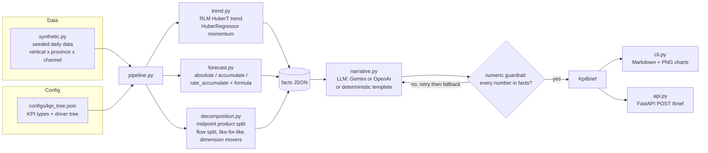
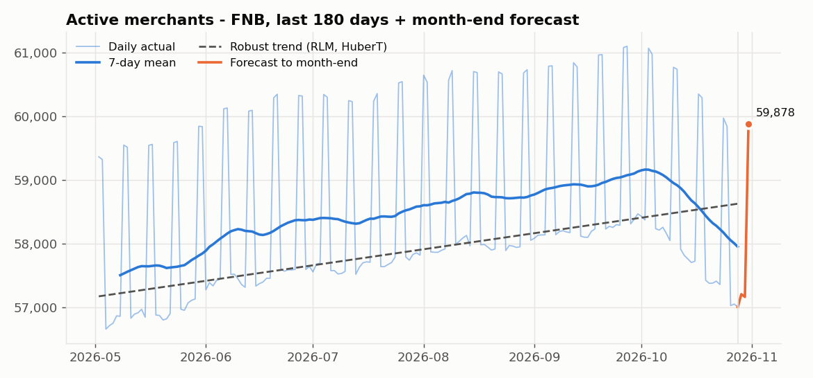
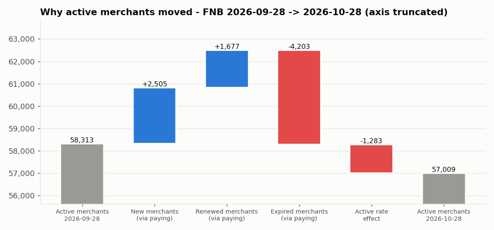
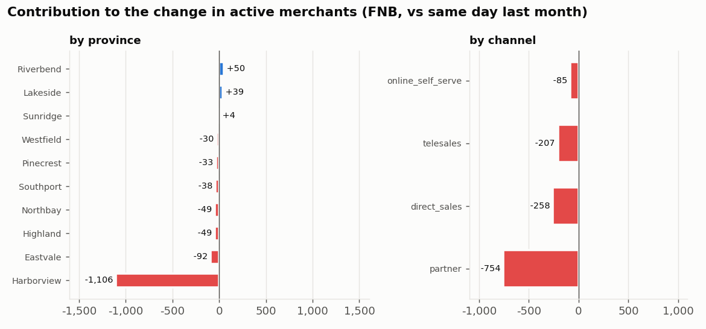

# KPI Insight Engine

**Automated daily KPI briefs: trend, month-end forecast, root-cause decomposition, top dimension movers and an LLM-written (but fact-checked) narrative.**

> All data in this repository is **synthetic**, generated by a seeded simulator (`kpi_insight/synthetic.py`). Names of provinces and channels are fictional and no figure reflects any real company.

## The problem

Leadership at a multi-vertical POS SaaS (merchants in the verticals `fnb`, `retail`, `spa` and `hotel`) gets daily KPI dashboards. The dashboards show *what* changed but not *why*. Every morning an analyst has to answer the same questions by hand:

- Is the headline KPI (active merchants) trending up or down, and is the trend speeding up or slowing down?
- Where will we land at month-end?
- Did we drop because fewer merchants are paying, or because paying merchants are less active?
- Which province or sales channel is responsible?

The engine answers those questions automatically and writes them up as a short brief.

## Approach



The KPI driver tree (`configs/kpi_tree.json`) is configuration, not code:

```
active_merchant = paying_merchant x active_rate                 (product)
paying_merchant[t] = paying_merchant[t-1] + new - expiry + renewed   (flow)
```

| Module | What it does |
|---|---|
| `synthetic.py` | ~3 years (Nov 2023 to Oct 2026) of daily data for 4 verticals x 10 provinces x 4 sales channels. Poisson acquisition with weekly seasonality, a yearly cycle and growth; binomial expiries; renewals driven by recent expiries. The stock identity `paying_t = paying_{t-1} + new - expiry + renewed` holds exactly (integers) for every series. Two injected shocks in the last month: the active rate in **Harborview** ramps down ~12 pp, and **partner**-channel acquisition steps down 40%. |
| `driver_tree.py` | Loads and validates the KPI tree (JSON; YAML if PyYAML is installed). |
| `trend.py` | Robust linear trend with `statsmodels` RLM (Huber T norm) over 180 days: direction (by t-value), strength (by % change over the window) and growth per day. Momentum via `sklearn` `HuberRegressor` over the last 90 days, compared with the long-window slope (accelerating / steady / decelerating / reversing). |
| `forecast.py` | Month-end forecast by KPI type: `absolute` (stock: robust trend + day-of-week effects, extrapolated to month-end), `accumulate` (month-to-date + same-weekday averages for the remaining days), `rate_accumulate` (ratio of two accumulated forecasts), `rate` (ratio of two stock forecasts), plus the formula forecast `paying_end = paying_today + fc(new) - fc(expiry) + fc(renewed)` over the remaining days. Includes a rolling-origin backtest. |
| `decomposition.py` | (a) midpoint / Shapley split of `dA` for `A = B x C`; (b) additive flow split of the stock change; (c) like-for-like comparison with the same day of the previous month (month-to-date for flows); (d) dimension mover ranking with contribution, share of net change, share of gross movement, and a filter that ignores members smaller than 2% of the total. |
| `narrative.py` | Pydantic `KpiBrief(title, summary, drivers, recommendations)`, a provider-agnostic LLM layer and a deterministic template, plus the numeric guardrail. |
| `api.py` / `cli.py` | FastAPI service and command-line report generator (Markdown + charts). |

## How to run

Python 3.11+.

```bash
pip install -r requirements.txt

# 1. daily brief -> reports/brief_fnb_2026-10-28.md (+ .json) and docs/img/*.png
python -m kpi_insight.cli --vertical fnb --date 2026-10-28

# 2. forecast backtest -> reports/backtest.md
python -m kpi_insight.backtest

# 3. tests
python -m pytest -q

# 4. API
uvicorn kpi_insight.api:app --port 8000
curl -X POST localhost:8000/brief -H "Content-Type: application/json" \
     -d '{"vertical": "fnb", "date": "2026-10-28"}'

# 5. Docker
docker build -t kpi-insight-engine .
docker run --rm -p 8000:8000 kpi-insight-engine
```

A `Makefile` wraps the same commands (`make brief VERTICAL=spa DATE=2026-10-15`, `make test`, `make serve`, ...). Valid dates run from 2024-04-29 (180 days of history are needed) to 2026-10-31.

**LLM narrative (optional).** Without an API key the engine uses the deterministic template, so everything runs offline. To use an LLM:

| Variable | Meaning |
|---|---|
| `KPI_LLM_PROVIDER` | `auto` (default: use whichever key is set), `gemini`, `openai`, or `none` |
| `GEMINI_API_KEY` / `GOOGLE_API_KEY` | enables Gemini via `google-genai` (structured JSON output) |
| `OPENAI_API_KEY` | enables OpenAI via `openai` (through `instructor` if installed) |
| `KPI_LLM_MODEL` | model override (defaults: `gemini-2.5-flash`, `gpt-4o-mini`) |

The LLM SDKs are imported lazily and are not in the core requirements: `pip install google-genai` or `pip install openai instructor`.

## Sample output

Generated with `python -m kpi_insight.cli --vertical fnb --date 2026-10-28` (full report: [`reports/brief_fnb_2026-10-28.md`](reports/brief_fnb_2026-10-28.md)).

> **FNB 2026-10-28: active merchants down 1,304 (-2.2%) vs same day last month**
>
> Active merchants stand at 57,009, down 1,304 (-2.2%) versus the same day last month (2026-09-28). Active rate is 73.3% (-1.6 pp), while paying merchants moved -28. The 180-day robust trend is up (moderate, +2.5% over the window) and momentum is decelerating. Month-end forecast (2026-10-31, a Saturday): 59,878 active merchants.
>
> **Drivers**
> - Expired merchants (via paying merchants): -4,203 active merchants.
> - New merchants (via paying merchants): +2,505 active merchants.
> - Renewed merchants (via paying merchants): +1,677 active merchants.
> - Active rate effect: -1,283 active merchants.
> - Active merchants by province: Harborview -1,106 (84.8% of the net -1,304 change).
> - Active rate by province: Harborview -1.42 pp (86.0% of the net -1.65 pp change); its own rate 76.2% -> 64.8%.
> - New merchants month-to-date by channel: partner -304 (144.8% of the net -210 change).
>
> **Recommendations**
> - Investigate engagement in Harborview: its active rate went from 76.2% to 64.8% (effect -1,111 active merchants). Check incidents, support tickets and field-team coverage there.
> - Review acquisition in the partner channel: month-to-date new merchants 930 -> 626. Confirm pipeline and partner activity.

Both injected shocks are recovered: the province ranking points at Harborview's active rate, and the acquisition ranking points at the partner channel. The month-end forecast is above today's value because 31 Oct is a Saturday, and active rate is higher at weekends in this vertical; the forecast models day-of-week effects explicitly.

**KPI with robust trend and month-end forecast**



**Waterfall: paying-merchant flows and active-rate effect (midpoint decomposition; steps sum exactly to the change)**



**Top movers by province and channel**



## Backtest results (synthetic data)

Rolling origin over the **last 12 complete month-ends** (Nov 2025 to Oct 2026) x 4 verticals x forecast origins on day 7, 14 and 21 of each month: 144 forecasts per KPI. The metric is the MAPE of the month-end value. Full table: [`reports/backtest.md`](reports/backtest.md).

| KPI | Type | Model MAPE | Naive MAPE | Seasonal-naive MAPE | vs naive | vs best baseline |
|---|---|---:|---:|---:|---:|---:|
| active_merchant | absolute | **0.48%** | 2.68% (last value) | 0.65% | +82% | +26% |
| paying_merchant | absolute | **0.19%** | 0.36% (last value) | 0.44% | +48% | +48% |
| paying_merchant (formula) | formula | **0.16%** | 0.36% (last value) | 0.44% | +55% | +55% |
| active_rate | rate | 0.44% | 2.63% (last value) | **0.42%** | +83% | -5% |
| new_merchant | accumulate | **2.71%** | 3.60% (MTD run-rate) | - | +25% | +25% |
| expiry_merchant | accumulate | **1.78%** | 2.43% (MTD run-rate) | - | +27% | +27% |
| renewed_merchant | accumulate | **2.86%** | 4.27% (MTD run-rate) | - | +33% | +33% |
| renewal_ratio | rate_accumulate | **3.31%** | 4.65% (MTD ratio) | - | +29% | +29% |

How to read this honestly:

- **These numbers are on synthetic data** whose generating process is known and fairly regular. They show that the method behaves sensibly, not how it performs on a real business.
- Much of the gain over the plain "last value" baseline for active merchants and active rate comes from the **day-of-week effect** (the month-end may fall on a weekend). Against a seasonal-naive baseline the gain shrinks, and for active rate the model is slightly worse (0.44% vs 0.42%), partly because the injected October shock breaks the trend.
- The **formula forecast** for paying merchants (current stock + forecast flows) beats direct extrapolation of the stock, which is why the engine reports both.
- Errors shrink as the month progresses (day 7 -> day 21: new merchants 4.1% -> 1.4%), as expected.

## Design decisions

**Why robust regression (RLM / Huber).** Daily KPIs contain holiday spikes, outages and back-filled data. Ordinary least squares lets a handful of these points tilt the slope and flip the reported direction. The Huber norm behaves like least squares for typical residuals and like least absolute deviation for large ones, so outliers are down-weighted rather than deleted, and no manual outlier rules are needed. The same idea is used for momentum (`HuberRegressor` on the last 90 days) and for the stock forecast.

**Why midpoint (Shapley) decomposition.** For `A = B x C`, the common "change B first, then C" split leaves an interaction term or assigns it arbitrarily, and the answer depends on the order. The midpoint rule `B-effect = dB * (C0 + C1) / 2`, `C-effect = dC * (B0 + B1) / 2` is the two-player Shapley value: it is symmetric, does not depend on order, and the effects **sum exactly** to `dA` with no residual (unit-tested). The same rule splits an aggregate rate into per-member rate and mix effects, and the B-effect can be further split across B's flows because it is linear in `dB`. As a result, every bar in the waterfall and every row in the mover table adds up to the headline change.

**Why like-for-like and a size filter.** Comparing with the same day of the previous month keeps month-to-date flows comparable (same number of elapsed days). Members below 2% of the total size are excluded from the ranking (but never from the totals), because small bases produce large percentage swings that are noise. Share of *gross* movement is reported next to share of *net* change, because net shares go above 100% whenever positive and negative movers cancel out.

**Why the LLM is constrained to computed facts.** The LLM's job is wording, not arithmetic. It receives a JSON of computed facts and must return a schema-validated `KpiBrief`. A guardrail then extracts every number from the text and checks it against the facts, allowing only the rounding implied by how the number is printed (`57k` = 57,000 +/- 500, `73.3%` +/- 0.05). If a number cannot be traced, the LLM is re-prompted with the offending numbers; after the retry budget the deterministic template is used. A brief that is wrong but confident is worse than no brief, so the system fails closed. The template also runs offline, which keeps the repository runnable and the tests deterministic.

## Project layout

```
kpi-insight-engine/
├── configs/kpi_tree.json      # KPI types + driver tree
├── kpi_insight/
│   ├── synthetic.py           # seeded data generator
│   ├── driver_tree.py         # config loader
│   ├── trend.py               # RLM trend + Huber momentum
│   ├── forecast.py            # month-end forecasts + backtest
│   ├── decomposition.py       # product / flow / like-for-like / movers
│   ├── pipeline.py            # builds the facts dict
│   ├── narrative.py           # KpiBrief, LLM layer, template, guardrail
│   ├── charts.py, report.py   # PNG charts, Markdown report
│   ├── cli.py, backtest.py    # entry points
│   └── api.py                 # FastAPI
├── tests/                     # pytest
├── reports/                   # sample brief + backtest (generated)
├── docs/img/                  # charts (generated)
├── Dockerfile, Makefile, requirements.txt
```

## Production version

This was originally built and deployed internally as a containerized FastAPI service writing to a data lake. This repo is a clean-room rewrite on synthetic data: no code, data, schema or figures from the original system are included.

## License

MIT, see [LICENSE](LICENSE).
