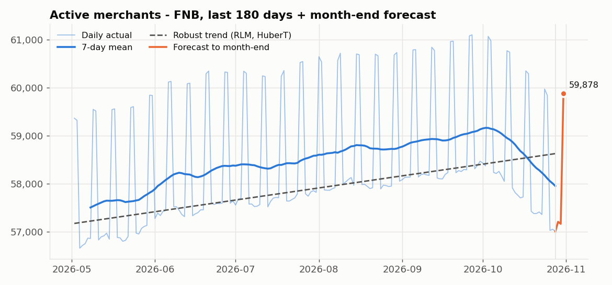
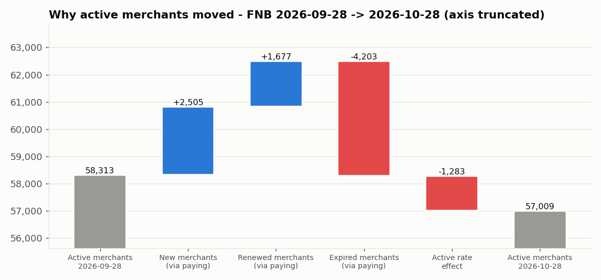
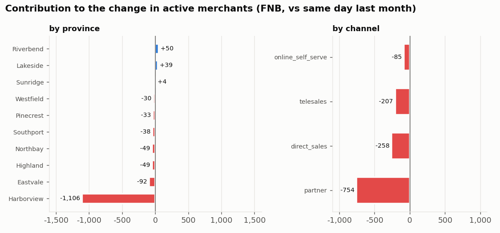

# FNB 2026-10-28: active merchants down 1,304 (-2.2%) vs same day last month

*Vertical:* `fnb` | *Date:* 2026-10-28 | *Compared with:* 2026-09-28 (same day previous month) | *Narrative source:* `template` | *Data:* synthetic

## Summary

Active merchants stand at 57,009, down 1,304 (-2.2%) versus the same day last month (2026-09-28). Active rate is 73.3% (-1.6 pp), while paying merchants moved -28. The 180-day robust trend is up (moderate, +2.5% over the window) and momentum is decelerating. Month-end forecast (2026-10-31, a Saturday): 59,878 active merchants.

## Drivers

- Expired merchants (via paying merchants): -4,203 active merchants.
- New merchants (via paying merchants): +2,505 active merchants.
- Renewed merchants (via paying merchants): +1,677 active merchants.
- Active rate effect: -1,283 active merchants.
- Active merchants by province: Harborview -1,106 (84.8% of the net -1,304 change).
- Active rate by province: Harborview -1.42 pp (86.0% of the net -1.65 pp change); its own rate 76.2% -> 64.8%.
- New merchants month-to-date by province: Eastvale -46 (21.9% of the net -210 change).
- Active merchants by channel: partner -754 (57.8% of the net -1,304 change).
- Active rate by channel: partner -0.96 pp (58.3% of the net -1.65 pp change); its own rate 74.4% -> 72.3%.
- New merchants month-to-date by channel: partner -304 (144.8% of the net -210 change).

## Recommendations

- Investigate engagement in Harborview: its active rate went from 76.2% to 64.8% (effect -1,111 active merchants). Check incidents, support tickets and field-team coverage there.
- Review acquisition in the partner channel: month-to-date new merchants 930 -> 626. Confirm pipeline and partner activity.

## KPI table

| KPI | Basis | Current | Same day last month | Change | Change % | Month-end forecast | Trend (180d) |
|---|---|---:|---:|---:|---:|---:|---|
| Active merchants | level | 57,009 | 58,313 | -1,304 | -2.2% | 59,878 | up, moderate, momentum decelerating |
| Paying merchants | level | 77,798 | 77,826 | -28 | -0.0% | 77,856 (formula: 77,798) | up, moderate, momentum decelerating |
| Active rate | level | 73.3% | 74.9% | -1.6 pp | -2.2% | 76.9% | flat, weak, momentum accelerating |
| New merchants | month-to-date | 3,115 | 3,325 | -210 | -6.3% | 3,451 | - |
| Expired merchants | month-to-date | 5,313 | 5,359 | -46 | -0.9% | 5,879 | - |
| Renewed merchants | month-to-date | 2,126 | 2,168 | -42 | -1.9% | 2,356 | - |
| Renewal ratio | month-to-date | 40.0% | 40.5% | -0.4 pp | -1.1% | 40.1% | - |

## Charts

## Top movers

**Active merchants by province** (net change -1,304; members <2% of size filtered: 0)

| Member | Contribution | Share of net change | Share of gross movement | Previous | Current |
|---|---:|---:|---:|---:|---:|
| Harborview | -1,106 | 84.8% | 74.2% | 7,471 | 6,365 |
| Eastvale | -92 | 7.1% | 6.2% | 7,680 | 7,588 |
| Riverbend | +50 | -3.8% | 3.4% | 6,071 | 6,121 |
| Highland | -49 | 3.8% | 3.3% | 5,379 | 5,330 |
| Northbay | -49 | 3.8% | 3.3% | 8,380 | 8,331 |

**Active rate by province** (net change -1.65 pp; members <2% of size filtered: 0)

| Member | Contribution | Share of net change | Share of gross movement | Previous | Current |
|---|---:|---:|---:|---:|---:|
| Harborview | -1.42 pp | 86.0% | 74.5% | 76.2% | 64.8% |
| Eastvale | -0.11 pp | 7.0% | 6.0% | 72.9% | 71.9% |
| Riverbend | +0.07 pp | -4.1% | 3.5% | 76.8% | 77.6% |
| Highland | -0.06 pp | 3.7% | 3.2% | 73.8% | 73.6% |
| Northbay | -0.06 pp | 3.6% | 3.1% | 74.9% | 74.0% |

**New merchants by province** (net change -210; members <2% of size filtered: 0)

| Member | Contribution | Share of net change | Share of gross movement | Previous | Current |
|---|---:|---:|---:|---:|---:|
| Eastvale | -46 | 21.9% | 19.8% | 448 | 402 |
| Harborview | -42 | 20.0% | 18.1% | 453 | 411 |
| Pinecrest | -36 | 17.1% | 15.5% | 261 | 225 |
| Riverbend | -35 | 16.7% | 15.1% | 348 | 313 |
| Lakeside | -23 | 11.0% | 9.9% | 293 | 270 |

**Active merchants by channel** (net change -1,304; members <2% of size filtered: 0)

| Member | Contribution | Share of net change | Share of gross movement | Previous | Current |
|---|---:|---:|---:|---:|---:|
| partner | -754 | 57.8% | 57.8% | 17,693 | 16,939 |
| direct_sales | -258 | 19.8% | 19.8% | 23,263 | 23,005 |
| telesales | -207 | 15.9% | 15.9% | 10,475 | 10,268 |
| online_self_serve | -85 | 6.5% | 6.5% | 6,882 | 6,797 |

**Active rate by channel** (net change -1.65 pp; members <2% of size filtered: 0)

| Member | Contribution | Share of net change | Share of gross movement | Previous | Current |
|---|---:|---:|---:|---:|---:|
| partner | -0.96 pp | 58.3% | 58.3% | 74.4% | 72.3% |
| direct_sales | -0.32 pp | 19.5% | 19.5% | 75.1% | 73.8% |
| telesales | -0.26 pp | 15.8% | 15.8% | 75.2% | 73.4% |
| online_self_serve | -0.11 pp | 6.4% | 6.4% | 75.2% | 73.9% |

**New merchants by channel** (net change -210; members <2% of size filtered: 0)

| Member | Contribution | Share of net change | Share of gross movement | Previous | Current |
|---|---:|---:|---:|---:|---:|
| partner | -304 | 144.8% | 74.9% | 930 | 626 |
| direct_sales | +69 | -32.9% | 17.0% | 1,377 | 1,446 |
| online_self_serve | +29 | -13.8% | 7.1% | 398 | 427 |
| telesales | -4 | 1.9% | 1.0% | 620 | 616 |

---
*Generated by kpi-insight-engine on synthetic data. Every number above comes from the computed facts; the narrative is checked by a numeric guardrail.*
